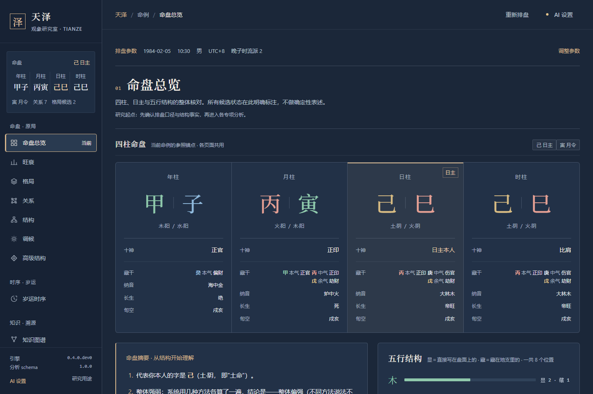

# 天泽 Tianze

天泽是用于四柱八字研究的本地工作台和 Python 分析引擎。输入出生时间后，可以从四柱排盘逐层查看旺衰、格局和岁运。展开一项判断，可以核对它引用的规则、古籍出处和验证状态。不同流派对同一命例的判断并列呈现，方便比较。

[本地启动](#本地启动) · [命令行与 Python](#命令行与-python) · [使用指南](docs/user-guide.md) · [开发与验证](#开发与验证)



## 在工作台里研究一个命例

| 你想了解什么 | 从哪里看 |
| --- | --- |
| 出生时间如何换算为四柱？ | **命盘总览**展示干支、藏干、十神和五行计数。调整时区或晚子时流派后可重新排盘。 |
| 几种方法为何得出不同判断？ | **旺衰、格局与调候**列出各方法的判断和依据，可回到原局逐项核对。 |
| 进入某个大运或流年后，哪些关系发生了变化？ | **岁运时序**按大运、流年、流月和流日逐层展开，并提供规则触发记录与状态回放。 |
| 如何复核一条规则、保存一次分析？ | **知识图谱**关联规则、来源和命例。**研究报告**汇总当前分析，支持打印。命令行可导出 Markdown 或 HTML。 |

## 本地启动

准备 **Python 3.12 或更高版本**，以及 **Node.js 22** 和 npm。仅使用 Python SDK 或命令行时，只需安装 Python。

**1. 获取源码并创建虚拟环境**

```sh
git clone https://github.com/BobSong-dev/tianze.git
cd tianze
python -m venv .venv
```

**2. 激活虚拟环境**

Windows PowerShell：

```powershell
.\.venv\Scripts\Activate.ps1
```

macOS 或 Linux：

```sh
source .venv/bin/activate
```

**3. 安装依赖并启动工作台**

```sh
python -m pip install -e ".[api]"
npm --prefix apps/web ci
python scripts/dev_start.py
```

打开 [本地工作台](http://127.0.0.1:5173)，输入出生日期、时间和性别，点击「开始排盘」。接口可在 [本地 API 文档](http://127.0.0.1:8000/docs) 中试用。按 `Ctrl+C` 停止服务。Windows PowerShell 若限制运行 npm 脚本，可使用 `npm.cmd`。

**AI 解读为可选功能。** 排盘和规则分析均可在本地完成。需要文字解读时，打开「AI 设置」填写服务地址、模型和 API Key。页面保存的密钥保存在服务进程内存中，重启后需重新填写。生成解读时，所选模型服务会收到该命例的结构与证据摘要。

## 命令行与 Python

在仓库根目录的虚拟环境中执行 `python -m pip install -e .` 即可使用 CLI 和 SDK。已安装上述工作台依赖的用户可直接运行示例。

```sh
tianze analyze --date 2003-08-18 --time 14:30 --gender male
tianze timeline --date 2003-08-18 --time 14:30 --gender male --year 2026
tianze export --date 2003-08-18 --time 14:30 --gender male --format html --out report.html
```

在 Python 中可以直接读取结构化结果，例如取出同一命例的日干：

```python
from tianze import analyze

result = analyze({"date": "2003-08-18", "time": "14:30", "gender": "male"})
print(result.pillars["day"]["stem"])
```

## 开发与验证

Python 引擎负责历法、排盘和规则计算，FastAPI 提供接口，Vue 3 工作台展示分析结果。历法底层依赖 `lunar-python`。各层的数据约定与来源见 [架构说明](docs/ARCHITECTURE.md)、[流派与计算口径](docs/CONVENTIONS.md) 和 [来源与许可](docs/SOURCES.md)。

<details>
<summary><strong>运行测试、生产构建与发布检查</strong></summary>

在仓库根目录安装开发依赖并运行 Python 测试：

```sh
python -m pip install -e ".[dev,api]"
python -m pytest tests apps/api/tests -q
```

在已安装前端依赖的环境中运行：

```sh
cd apps/web
npm test
npm run api:check
npm run build
npx playwright install chromium
npm run test:e2e -- --retries=0
```

端到端测试会启动独立的前后端服务。回到仓库根目录后，可用 `python tools/quality_gate.py` 执行完整质量门。它会刷新回归与发布工件，建议在独立工作副本中运行。详见[发布流程](docs/release-procedure-v0.4.0.md)。

</details>

## 延伸阅读

- **使用与边界**　[工作台使用指南](docs/user-guide.md) · [已知限制](docs/known-limitations.md)
- **研究与复核**　[规则来源追踪](docs/knowledge/04-SOURCE-PROVENANCE.md) · [知识验证机制](docs/knowledge/07-VERIFICATION-SYSTEM.md) · [勘误记录](docs/ERRATA.md)
- **开发与演进**　[开发指南](docs/developer-guide.md) · [设计决策](docs/DECISIONS.md) · [版本治理](docs/VERSIONING.md)

天泽面向传统文化研究与工程实践。阅读命例时，请将规则推导与现实决策区分开来。
