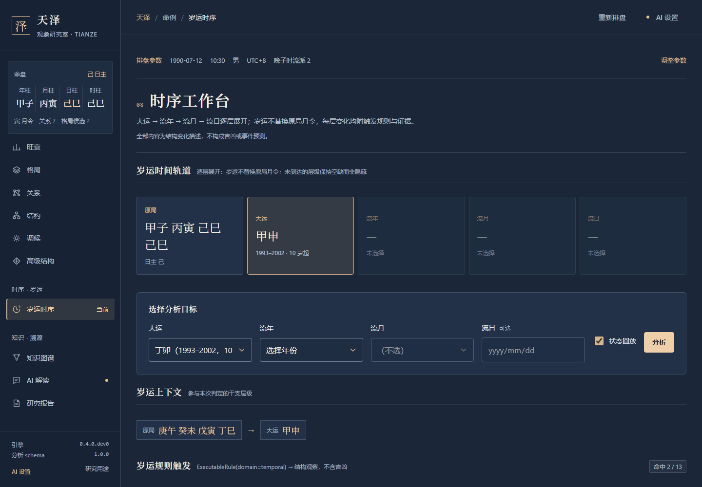
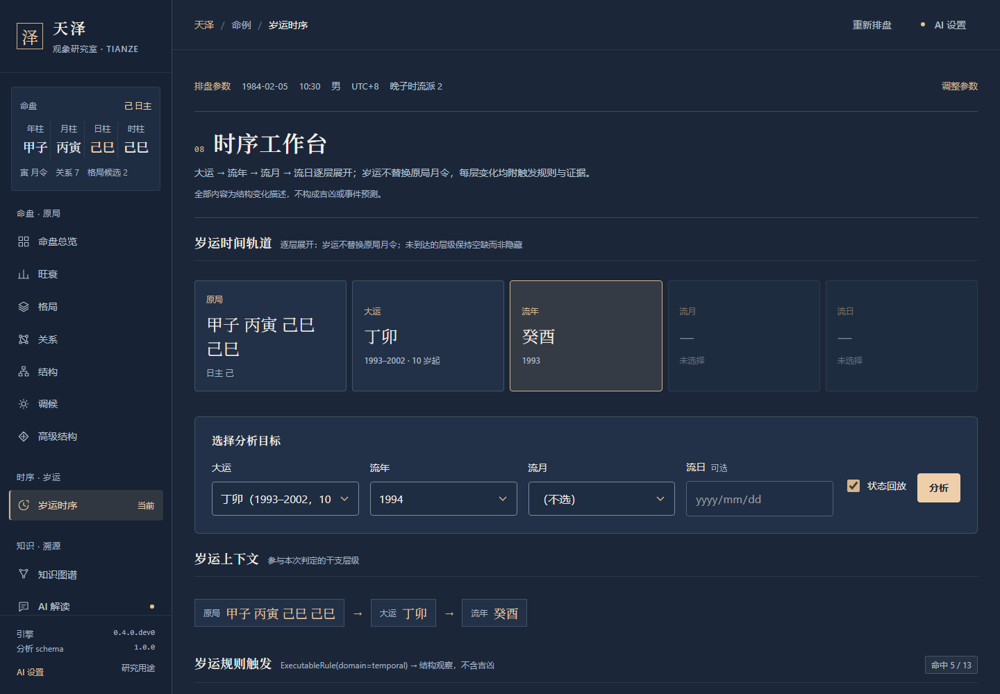
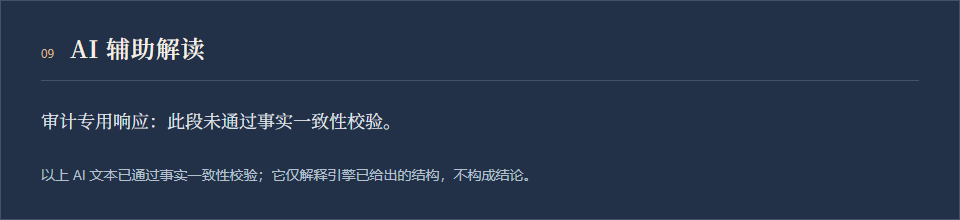
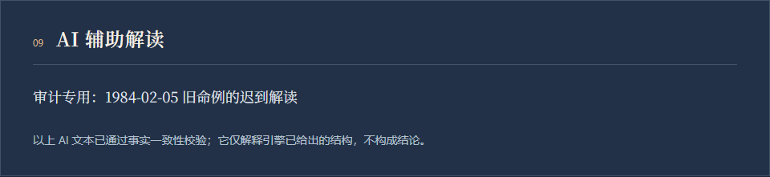
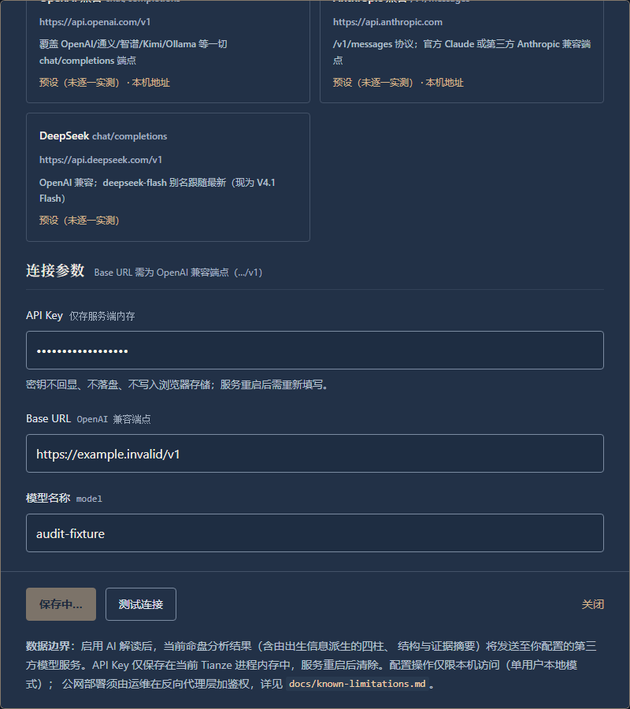
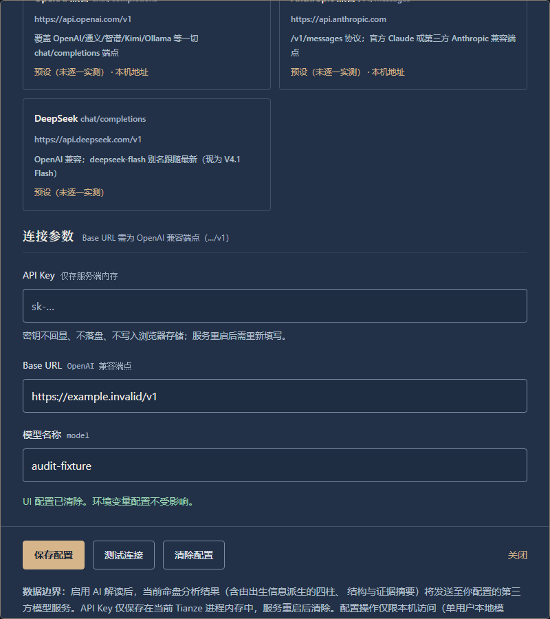
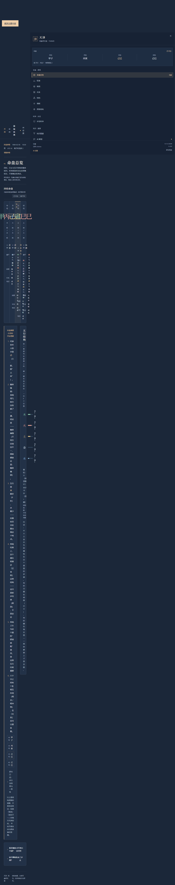
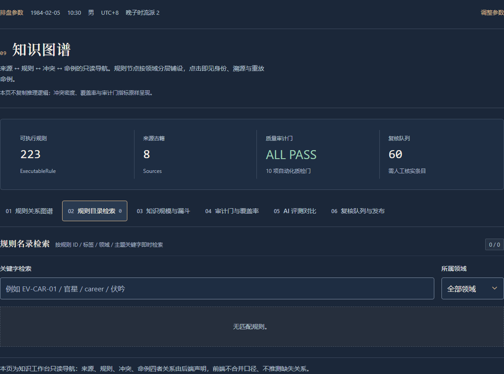
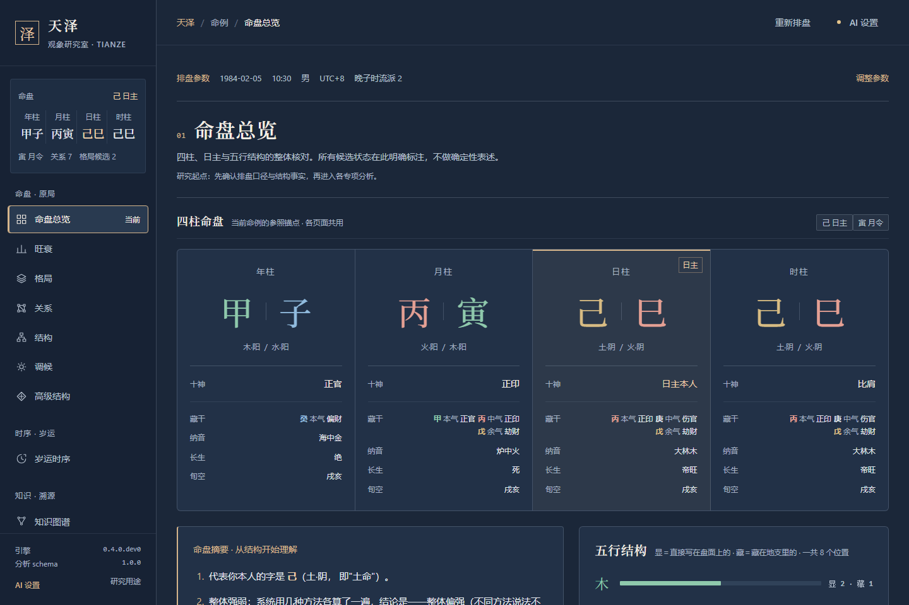
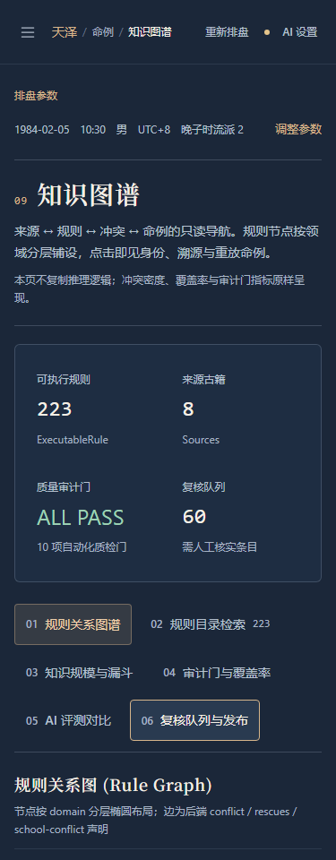

# 天泽项目复测报告

**后续更新：本报告是修复前基线。13 项问题的处理及最新测试结果见 [修复验收报告](2026-11-20-remediation.html)。**

测试日期：2026 年 11 月 20 日（Asia/Shanghai）｜范围：当前工作区，包含尚未提交的前端重构｜性质：测试与审计，未实施产品修复。

## 结论

**常规使用路径可用，但目前不宜按“可正式交付”验收。** 生产构建、类型检查、前端单测和常规浏览器测试通过；完整后端测试在 UTF-8 环境下通过。补充边界测试复现了命例数据混用、迟到响应污染、报告错误宣称 AI 校验通过、保存失败无法恢复及移动端键盘问题。

共记录 **9 项浏览器可复现问题、4 项工程与验证问题**。这些是问题表现，不等同于 13 个独立根因；F02/F04 可由统一请求版本机制共同处理。优先级按影响判断，不代表发生频率或安全漏洞评级。

- **P1，交付前处理：** F01–F04 的数据与报告可信度问题；F12 的 CI 版本断言；F13 的发布检查误放行。
- **P2，随后处理：** F05–F09 的错误恢复与交互问题；F10 的契约检查；F11 的 Windows 编码可复现性。
- **未发现不等于不存在：** 本轮不是完整安全审计、命理正确性鉴定或跨平台认证；真实云端 AI、Firefox/Safari 和真实移动设备不在已验证范围内。

## 环境与隔离

| 项目 | 本轮实际情况 |
| --- | --- |
| 基准提交 | `07b6e30e59443eac8fbcba04f1b369745898d197`，同时包含当前未提交重构 |
| 前端 | Vue 3.5.43、TypeScript 5.9.3、Vite 6.4.3；自建组件与 CSS，无 Vue Router |
| 后端 | Python 3.14.7、FastAPI 0.142.2、Pydantic 2.13.5、Uvicorn 0.54.0 |
| 测试 | pytest 9.1.1、Vitest 5.0.3、Playwright 1.63.0，Chromium 无头浏览器 |
| 产品版本 | `0.4.0.dev0`；本地 Python 版本不同于 CI 的 3.12/3.13 矩阵 |
| 实际测试地址 | 隔离前端 `127.0.0.1:5183`，隔离 API `127.0.0.1:8010` |
| 用户预览地址 | 原有 `127.0.0.1:5173` / `127.0.0.1:8000` 不用于破坏性测试，未停止 |

隔离副本位于 `C:/Project/tianze/apps/web/test-results/audit-20261120/workspace`。复制当前源码和 Git 信息，复用本地依赖；不复制 `.env`，不读取或使用真实 AI Key。原有 E2E 会设置/清除 API 进程内存配置，因此仅对隔离 API 执行。

Python 发布测试会写入 `release/`、回归记录并构建临时 wheel；这些写入均留在副本。新增产品仓库内容只有本报告及其阅读版、证据与复现附件，未改业务代码、接口、数据库或产品测试。

初次副本由于 Git 的中文路径转义漏拷 7 个已跟踪命例文件，产生 3 个数据缺失失败。已补齐并重新全量运行，这 3 项**不计入产品缺陷**。沙箱内第一次后端全测无输出，停止该审计进程后在沙箱外重跑；亦不作为产品卡死结论。

## 测试结果

| 检查 | 结果 | 说明 |
| --- | --- | --- |
| Vue/TypeScript 检查及生产构建 | 通过 | `npm.cmd run build`，包含 `vue-tsc -b` 和 Vite build |
| 前端单元测试 | 4/4 通过 | 2 个测试文件，`node node_modules/vitest/vitest.mjs run` |
| 原有 Playwright 测试 | 36/36 通过 | 禁用自动重试；最终结果对应补齐后的隔离副本 |
| 本轮补充浏览器探针 | 9/9 复现目标问题 | 这是“缺陷条件被确认”，不是 9 项产品验收通过 |
| 后端全量测试 | 670/670 通过，5 条警告 | 显式 UTF-8 环境，最终运行 87.41 秒，见 `python.xml` |
| Windows 默认编码差分测试 | 5/5 失败 | Node UTF-8 输出被 GBK 解码，见 F11；不是已证实的排盘差异 |
| API 契约检查 | 失败，退出码 1 | `npm.cmd run api:check`，见 F10 |
| CI 版本断言本地复演 | 失败，退出码 1 | 当前版本不等于硬编码 `0.3.0`，见 F12；未运行远端 CI |
| Lint | 未配置独立入口 | `package.json` 无 lint 脚本，`pyproject.toml` 无对应配置；不能称为通过 |

生产资源：JS 291.31 kB（gzip 97.60 kB），CSS 48.87 kB（gzip 10.63 kB）。这是产物大小，不是 Lighthouse/Core Web Vitals 成绩。

### 已覆盖页面与交互

| 页面或路径 | 已验证内容 |
| --- | --- |
| 首页与出生信息表单 | 节气切换、正常排盘、时区、晚子时流派、未知时辰；后端校验失败 UI 用响应注入覆盖 |
| 命盘总览、旺衰、格局 | 四柱、三种旺衰方法、格局候选与数据呈现 |
| 关系、结构、调候、高级结构 | 工作区可达、证据展开、结构和关系展示 |
| 岁运时序 | 大运/流年选择、分析、状态回放和规则入口；另补慢响应场景 |
| 知识图谱 | 图谱缩放/重置/选中、键盘切换、六个标签页、空搜索、全量失败后重试；另补单接口失败 |
| AI 解读及设置 | 本地 mock 配置/解释链路、未配置状态、弹窗焦点恢复；另补失败和竞态场景 |
| 研究报告 | 章节、目录、内容显示和打印媒体下的显隐；另补命例与 AI 校验状态核对 |
| 响应式 | 375/768/1440px 全部工作区；320px、812×375 横屏、1024px 和字号放大做冒烟检查 |

这里的“路径”是会话内工作区导航，而不是独立 URL 路由。当前项目不提供 Vue Router 式历史/深链接，本轮没有将这一产品设计自动判为缺陷。

## 浏览器确认的问题

### F01 P1 未提交参数混入既有命盘与岁运

**实际：** 先用 `1984-02-05 10:30` 排盘，再将参数日期改为 `1990-07-12`，不重新排盘。研究报告立即显示新日期，但四柱仍为旧命例的 `甲子 丙寅 己巳 己巳`。随后执行岁运，网络请求使用新日期，返回原局为 `庚午 癸未 戊寅 丁巳`；同一页面上方与下方出现两套原局。

**复现：** 首页排盘 → 调整参数 → 修改日期 → 收起 → 研究报告 → 岁运时序 → 选首个大运 → 分析。不需要网络故障或响应伪造。

**影响：** 报告的身份信息和计算结果不一致，岁运上下文与原局混用；后续 AI 输入也可能继承混合数据。用户无法仅凭页面确认报告对应哪个命例。

**定位：** `C:/Project/tianze/apps/web/src/composables/useTianze.ts:209` 从可编辑 `state.birth` 构造请求；`C:/Project/tianze/apps/web/src/views/ReportView.vue:77` 直接显示同一草稿；App 的报告参数也直接传草稿。

**建议与验收：** 区分编辑草稿和成功分析快照；报告、岁运和 AI 只消费同一已提交版本。修改草稿应提示“尚未重新排盘”，或使相关分析入口失效。按以上步骤重复时，页面不得出现新日期与旧结果、两套原局混用。



### F02 P1 慢岁运响应覆盖新的年份选择

**实际：** 请求分析 1993 年，暂扣真实 API 响应；在响应到达前将流年改为 1994 年，再释放响应。选择框保留 1994，时间轨道及结果却显示 1993 年癸酉。

**复现：** 排盘 → 岁运 → 首个大运及首个年份 → 分析 → 请求未结束时改选下一年 → 等待旧响应。测试仅延迟真实响应，没有改写引擎结果。

**定位：** `C:/Project/tianze/apps/web/src/composables/useTianze.ts:279` 无请求版本核对便写回 `temporal`；年份切换只清结果，不阻止旧请求写回。

**建议与验收：** 请求携带命例版本和选择快照，返回时核对；可辅以 AbortController。使用可控响应顺序重测，旧结果必须丢弃或明确标注其分析目标，不得伪装成当前选择。



### F03 P1 AI 校验失败被报告写成已通过

**实际：** 注入 `groundingPassed:false` 和一条校验问题。AI 页正确显示“有 1 处说法与引擎对不上”，研究报告却无条件显示“以上 AI 文本已通过事实一致性校验”。

**复现：** 配置状态响应为测试专用已配置状态 → 生成带校验失败的测试解读 → 切换研究报告。截图里的“审计专用响应”是明确标识的测试 fixture，不是真实模型输出，也未保存为业务数据。

**影响：** 用户阅读、打印或转交报告时丢失重要的可信度警告。免责声明“仅供参考”不能抵消事实状态标错。

**定位：** `C:/Project/tianze/apps/web/src/views/ReportView.vue:399` 仅判断 summary 是否存在；`:422` 无条件宣称通过。

**建议与验收：** 原样传播校验通过、失败、未知状态，展示问题摘要；失败/缺失状态均不得显示通过。对三种状态分别添加报告断言，包括打印模式。



### F04 P1 重新排盘后收到旧命例的 AI 解读

**实际：** 为 1984 年命例发起 AI 请求并暂扣响应，重新排盘为 `1990-07-12`；释放旧响应后，新命例报告出现旧命例解读。

**复现：** AI 生成中 → 调整出生日期 → 顶栏重新排盘 → 等待旧 AI 返回 → AI 页/研究报告。AI 内容为带“旧命例”字样的测试 fixture，故能明确识别归属；未调用外部服务。

**定位：** `C:/Project/tianze/apps/web/src/composables/useTianze.ts:228` 重置 AI，但并未使在途请求失效；`:313` 的异步返回仍可写入新会话结果。

**建议与验收：** AI 绑定生成时的命例与岁运版本；重排/上下文改变后丢弃旧响应。补测生成中重排、切换岁运、连续重试的不同返回顺序。



### F05 P2 保存 AI 配置遇断网后永久停在保存中

**实际：** 浏览器中中断 `/ai-config/set`，产生未处理的“网络错误”；按钮保持禁用的“保存中…”。关闭并重开设置仍不能保存。

**复现：** 打开设置 → 填测试参数 → 在该请求上断网 → 保存 → 重开弹窗。中断发生在浏览器，测试值未发送给后端。

**定位：** `C:/Project/tianze/apps/web/src/composables/useAiConfig.ts:62` 的 `save()` 没有 `catch/finally`，异常跳过 `saving=false`；网络工具在失败时抛异常。

**建议与验收：** 在 finally 恢复提交状态，显示可感知的错误并允许重试，保留用户输入。网络中断、非 JSON 响应等失败后不得卡住；重新保存应可成功。



### F06 P2 清除配置失败仍提示成功

**实际：** `/ai-config/clear` 返回 500 和 `ok:false`，UI 仍显示“UI 配置已清除”；状态区同时显示“页面配置 · audit-fixture”。

**复现：** 用测试状态显示已配置 → 注入清除接口 500 → 点击清除配置。测试没有清除真实凭据。

**定位：** `C:/Project/tianze/apps/web/src/composables/useAiConfig.ts:90` 忽略返回结果；`C:/Project/tianze/apps/web/src/api/tianze.ts:148` 的网络失败兜底 `{}` 也无法表达成功。

**影响：** 用户误以为服务端内存凭据已清除；这不是已观察到的凭据泄漏，但属于敏感操作的错误确认。

**建议与验收：** 只有后端确认成功后更新成功提示；失败保留原状态并明确提示重试。分别测试 403、500、断网及正常清除。



### F07 P2 移动抽屉打开时放大窗口会锁住桌面内容

**实际：** 375px 打开研究路径抽屉，再将窗口变成 1440px，菜单开关已隐藏，但 `.app-main` 仍 `inert=true`。点击“调整参数”被阻止。按 Escape 可恢复。

**定位：** `C:/Project/tianze/apps/web/src/components/AppShell.vue:58`、`:155` 仅由 `sidebarOpen` 管理焦点和 inert，没有断点变化清理。

**建议与验收：** 进入桌面断点时关闭移动模态状态、移除滚动锁并恢复焦点。移动到桌面和反向切换均需测试，不应依赖用户知道 Escape 才能恢复。



### F08 P2 抽屉内打开 AI 设置后 Tab 无法进入表单

**实际：** 375px 抽屉底部打开“AI 设置”，连续三次 Tab，焦点始终停留在弹窗右上角“关闭”，无法遍历预设和输入框。

**定位：** `C:/Project/tianze/apps/web/src/components/AppShell.vue:149` 打开设置却不关闭抽屉；`C:/Project/tianze/apps/web/src/composables/useFocusTrap.ts:32` 使两个焦点陷阱同时监听 document。父外壳 inert 后，抽屉监听仍会阻止 Tab 默认行为。

**建议与验收：** 打开设置前结束抽屉模态，或统一管理仅最上层生效的模态栈。验证 Tab/Shift+Tab 遍历、Escape 关闭顺序及焦点归还。仅从桌面顶栏测试弹窗不能覆盖此问题。

### F09 P2 规则目录接口失败被伪装为空数据

**实际：** 只有 `/knowledge/rules` 返回 500，其余接口正常。页面仍显示可执行规则 223、图谱正常；规则目录显示“无匹配规则”，没有错误提示和重试入口。

**定位：** `C:/Project/tianze/apps/web/src/api/tianze.ts:232` 未检查 HTTP 状态，并将失败规则兜底为 `[]`；`C:/Project/tianze/apps/web/src/views/KnowledgeView.vue:96` 仅检查 stats 和 graph。

**建议与验收：** 每个子资源区分 loading/error/empty/success。单一接口失败只影响相应面板，但必须显示错误和重试，不能将获取失败当作真实零条规则。



## 工程与验证问题

### F10 P2 API 检查脚本失败且契约文件落后

`npm.cmd run api:check` 退出码 1。`C:/Project/tianze/apps/web/scripts/generate-api-types.mjs:3` 将根目录解析为 `.../workspace/apps`，而不是仓库根；还在 shell 字符串中使用 Windows 下未正确处理的 `.venv/Scripts/python`。因此校验未真正执行，不能解释为“已经检出并阻止契约漂移”。

独立比较确认：已提交 OpenAPI 有 17 个 path、0 个 schema；实际应用有 22 个 path、3 个 schema。缺少 5 个 `/api/v1/ai-config/` 路径：`clear`、`presets`、`set`、`status`、`test`。

**建议与验收：** 正确定位根目录，使用参数数组调用解释器，兼容 Windows/POSIX；检查模式生成到临时目录并比较 JSON 和类型文件，不应先覆盖工作文件。干净状态成功、引入漂移失败、检查前后源码无变化。当前页面使用手写 API 封装，契约陈旧不等于这些功能全部不可用。

### F11 P2 默认 Windows 编码使差分测试失败

未设置 UTF-8 环境时，`tests/test_atlas_differential.py` 的 5 个用例全失败，伴随 GBK `UnicodeDecodeError`。`C:/Project/tianze/tests/test_atlas_differential.py:34` 用 `text=True` 接收 Node 的 UTF-8 JSON，但未指定编码。

显式设置 `PYTHONUTF8=1`、`PYTHONIOENCODING=utf-8` 后完整 670 项通过。仍有 5 条警告：1 条 Starlette/httpx 弃用警告、4 条子进程读取线程 UTF-8 解码异常警告（pytest 归属到 `test_three_harmony_positions_deterministic`）。警告的具体输出源尚未单独隔离，不能仅凭归属断言是该测试的业务逻辑错误。

**建议与验收：** 给跨语言子进程明确编码，统一文档及测试入口；继续定位残余线程警告，不只是把 warning 屏蔽。Windows 默认终端和 UTF-8 模式都应稳定通过，并验证子进程异常能使应失败的检查真正失败。

### F12 P1 当前代码与 CI 版本断言矛盾

`C:/Project/tianze/.github/workflows/ci.yml:38` 强制断言 `tianze.__version__ == '0.3.0'`；当前 `C:/Project/tianze/tianze/__init__.py:3` 是 `0.4.0.dev0`。原样在本地执行该断言，返回 `AssertionError`、退出码 1。

**影响：** 在依赖安装成功的前提下，该 CI 步骤会先于 pytest 失败；本地测试通过不能代表远端流水线通过。远端运行记录未查询，不声称已观察到 GitHub Actions 失败。

**建议与验收：** 按开发版本/发布 tag 建立单一版本来源校验，不把当前版本再硬编码到另一个位置；在 CI 使用的 Python 3.12/3.13 上验证。另需将 `apps/api/tests`、前端单测/E2E 和契约检查接入 CI；目前 workflow 的 Python 命令只跑 `tests`，web job 只构建。

### F13 P1 发布检查把质量门失败记录为 PASS

隔离运行内将 `release/quality-summary.json` 的读取结果替换为 `{allPass:false, failed:['AUDIT_INJECTED_FAILURE']}`，只执行到构建前即终止，**不改真实质量文件，不发布、不创建 tag**。

结果输出为 `PASS P0_quality_gate（WARN: 最近一次 quality summary 未 ALL PASS…）`。`C:/Project/tianze/tools/release_check.py:68` 对所有 `allPass:false` 都传 `True`，没有核对失败是否属于当前提交，注释中的“失败应 FAIL”与实现不一致。

**影响边界：** 已确认的是 P0 子步骤错误放行；没有据此声称整个 release 流程一定放行，因为其余步骤仍可能失败。

**建议与验收：** 当前版本质量门 FAIL 必须阻断发布；过期/缺失工件独立处理。如测试需绕过前置检查，应采用显式仅测试选项。补充 allPass=false、工件缺失、旧提交和正常通过的矩阵断言。

## 视觉与交互复核

使用已安装的 UI UX Pro Max 知识库核对错误恢复、表单反馈和键盘可达性；该 skill 作为检查依据，不作为自动“设计合格证”。

实际截图中，深靛蓝/古铜金、衬线标题和紧凑数据布局保持一致，首页与研究工作台有明确区别。375/768/1440px 所有工作区均通过页面级横向溢出断言；首页、总览、知识图谱、岁运及设置弹窗进行了截图目视复核。其他工作区保留了自动截图，可在阅读版的完整截图索引查看。

优先问题不是重新换一套颜色，而是“界面说的状态是否真实”和“用户是否能从失败中恢复”。F01–F09 正是这些交付风险。

仍有不应夸大为 bug 的优化项：移动岁运原局卡片纵向堆叠较高、时间轨道需要内部横向浏览；长篇结果信息密度高，可增加摘要和折叠。尚未完成逐元素色彩对比度、真实读屏及触控目标测量，因此不宣称 WCAG 合规。

打印验证只覆盖 Chromium 的打印媒体样式显隐，不等同于所有分页、字体嵌入和真实打印机输出都已验收。





## 建议修复顺序与验收门槛

1. **先保证报告可信度。** 处理 F01、F03，建立已提交命例快照和 AI 校验状态的单一来源。
2. **统一请求生命周期。** 处理 F02、F04；请求绑定命例/岁运版本，覆盖重排和乱序返回。
3. **恢复真实质量门。** 处理 F12、F13，再修复 F10；否则“构建绿”“发布 PASS”不足以证明可交付。
4. **完善恢复与可达性。** 处理 F05–F09；错误可见、操作可重试、只有一个模态焦点陷阱。
5. **补齐回归与环境矩阵。** 将上述失败场景改为期望正确行为的回归测试，解决 F11；按实际支持平台运行测试、浏览器及打印检查。

建议交付门槛：本报告 P1 全部关闭；P2 有修复或明确接受记录；现有 670 后端、4 前端、36 E2E 不回退；新增边界用例断言正确结果；契约/CI/发布检查真正可执行；真实 Provider 和跨浏览器未测项在对外声明中保留边界。

## 证据与复现附件

- [浏览器探针原始结果](2026-11-20-assets/browser-audit.json)：请求日期、原局字段、焦点步骤、错误文本和截图文件名。
- [工程探针原始结果](2026-11-20-assets/engineering-audit.json)：版本、OpenAPI 差异、CI 断言和 P0 输出。
- [最终后端 JUnit](2026-11-20-assets/python.xml)、[后端完整日志](2026-11-20-assets/python-utf8.log)、[默认编码失败日志](2026-11-20-assets/python-default.log)。
- [E2E 日志](2026-11-20-assets/e2e.log)、[前端单测日志](2026-11-20-assets/frontend-unit.log)、[构建日志](2026-11-20-assets/frontend-build.log)、[契约检查日志](2026-11-20-assets/api-check.log)。
- [浏览器复现脚本](2026-11-20-assets/browser-audit.mjs)、[工程复现脚本](2026-11-20-assets/engineering-audit.py)。脚本当前硬编码本机隔离地址；不要把清除配置的原有 E2E 指向正在使用的 API。

### 本轮执行命令

前端命令在隔离副本 `apps/web` 下执行：

```powershell
npm.cmd run build
node node_modules/vitest/vitest.mjs run
npm.cmd run api:check
$env:E2E_BASE_URL='http://127.0.0.1:5183'
$env:E2E_API_ORIGIN='http://127.0.0.1:5183'
node node_modules/@playwright/test/cli.js test --retries=0 --reporter=line
```

后端命令在隔离仓库根目录下执行，第一条在未设置 UTF-8 覆盖的进程中运行：

```powershell
.venv\Scripts\python.exe -m pytest tests/test_atlas_differential.py -q
$env:PYTHONUTF8='1'
$env:PYTHONIOENCODING='utf-8'
.venv\Scripts\python.exe -u -m pytest tests apps/api/tests -vv --junitxml=../python.xml
```

**本轮到此为审计交付，不包含问题修复。** 全部发现保留复现证据与验收条件，便于逐项评审和后续回归。
