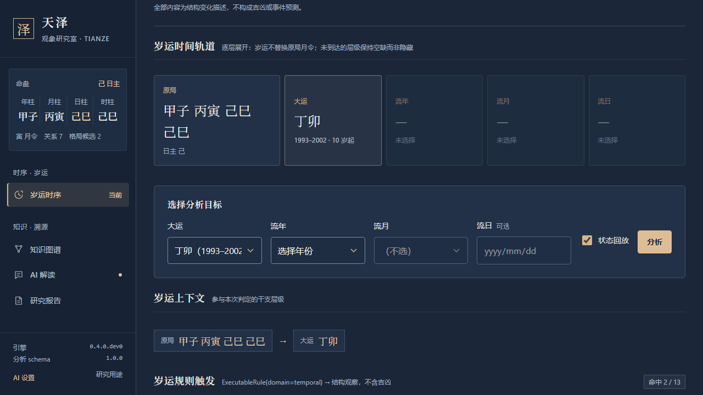
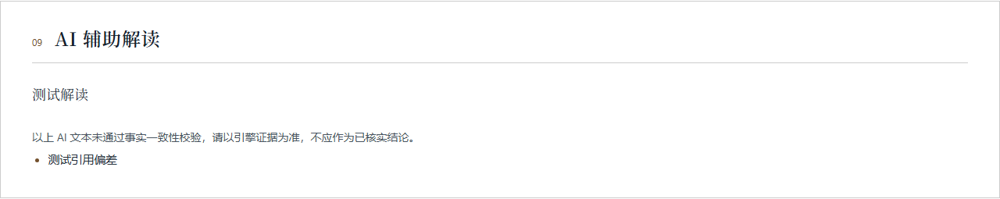
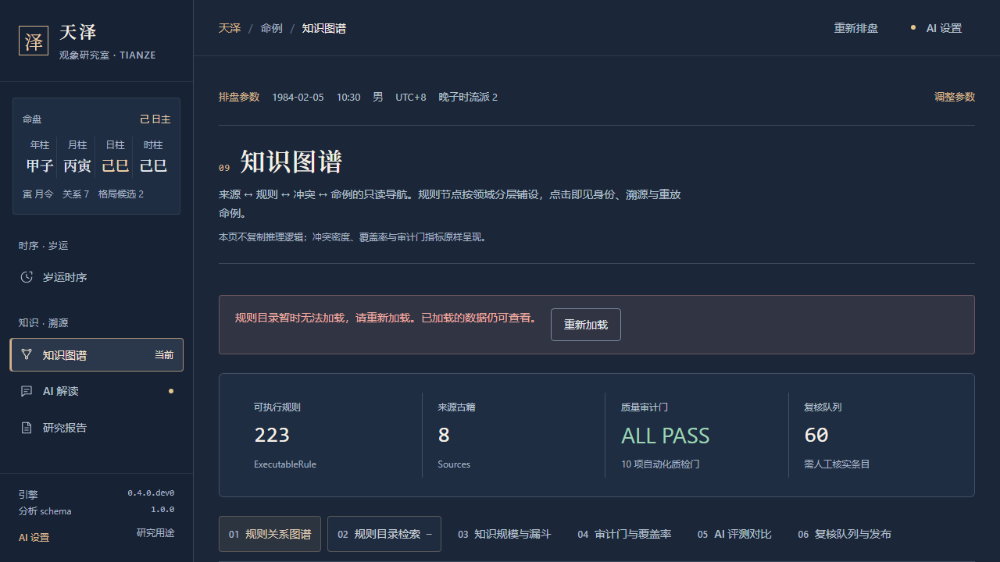
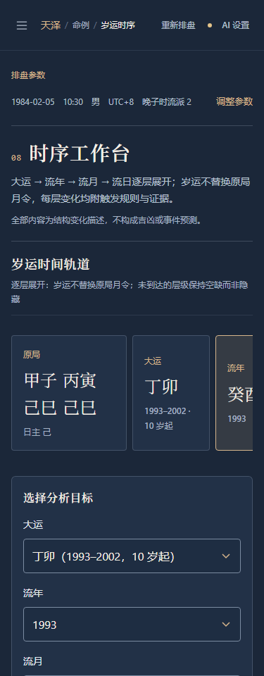

# 天泽审计问题修复验收

2026 年 11 月 20 日｜对应 [修复前审计报告](2026-11-20-project-review.html)｜保留当前工作区已有视觉重构，无提交、无发布。

## 结果

**报告中的 F01–F13 已完成针对性修复与本地验证。** 保留原业务接口、计算规则、数据来源和全部工作区入口；没有替换业务数据、引入新 UI 库或调用真实付费 AI。

重点改进是结果可信度和操作恢复：报告、岁运与 AI 绑定已提交命例；过期响应不能覆盖新上下文；校验失败不会被写成通过；失败操作可见、可重试；移动抽屉与设置弹窗不再争夺键盘焦点。

**这不是跨平台生产认证。** 远端 GitHub Actions 未执行，Firefox/Safari、真实移动设备和真实云端 Provider 未验证。保留 1 条当前 Starlette/httpx 兼容层弃用警告，未通过屏蔽 warning 伪造零警告。

## 验证汇总

| 验证 | 结果 | 证据或范围 |
| --- | --- | --- |
| 后端测试 | 684 项通过 | 默认 Windows 编码全测及 UTF-8 质量门中的全测 |
| 前端单元测试 | 33 项通过 | 原有 4 项 + 新增会话、AI 配置和知识数据测试 |
| 契约脚本测试 | 1 项通过 | 检出 JSON/类型漂移，检查模式不写源码，兼容 CRLF |
| 浏览器端到端 | 45 项通过 | 原有 36 项 + 新增 9 项审计回归；禁用重试 |
| 类型检查及生产构建 | 通过 | `vue-tsc -b` + Vite；未增加运行时依赖 |
| API 契约一致性 | 通过 | 22 个 path、3 个 schema；检查前后文件哈希一致 |
| 质量门 | 23 步通过 | 真实运行，124.3 秒，不是修改 PASS 标志 |
| 独立发布检查 | 8 步通过 | 质量门、wheel 构建、临时安装、CLI、版本等；没有发布 |
| 版本校验 | 通过 | 本地安装与源码一致，分支/tag 情况有 4 项测试 |
| 补丁空白检查 | 通过 | `git diff --check` |
| Lint | 项目未配置 | 不把类型检查或空白检查冒充 Lint |

生产资源：JS 295.53 kB（gzip 99.01 kB），CSS 48.99 kB（gzip 10.67 kB）。相对修复前增加约 4.2 kB JS，主要为状态保护、错误处理和反馈；没有以体积指标代替真实性能测量。

测试环境：Windows、Python 3.14.7、Vue 3.5.43、TypeScript 5.9.3、Vite 6.4.3、Playwright 1.63.0 Chromium。测试使用隔离副本与 5183/8010 服务，用户原有 5173/8000 服务及其 AI 配置未用于清除测试。

## 逐项修复

| 编号 | 修复内容 | 回归证据 |
| --- | --- | --- |
| F01 | 新增已提交出生信息快照；报告、参数读数、岁运使用快照。草稿变化显示“尚未重新排盘”。 | 修改日期不提交后，报告保持原日期，岁运请求保持原命例；单测与真实浏览器通过。 |
| F02 | 岁运请求版本随选择/重排失效；旧响应、旧错误和旧 finally 不得写回新请求。 | 可控乱序响应测试；慢响应期间改年份，旧结果丢弃，新结果正确。 |
| F03 | AI 和报告均区分通过、失败、未知；报告保留校验问题，打印模式也一致。 | true/false/缺失三种浏览器回归及状态单测通过。 |
| F04 | AI 绑定当前命例/岁运请求版本；重排、换年、切换回放、岁运重算及再次生成均使旧请求失效。 | AI 生成中重排、连续重试等单测；迟到旧命例响应浏览器回归通过。 |
| F05 | 保存采用 try/catch/finally；失败解除 loading，保留输入，可重试，错误提供 role=alert。 | 断网、非 JSON、403、500、业务失败测试及浏览器失败后重试通过。 |
| F06 | 清除仅在 HTTP 和业务结果均成功时确认；失败保留状态，添加互斥 loading。 | 403/500/断网/ok=false 均不显示成功；浏览器验证。 |
| F07 | 进入桌面断点时主动关闭移动抽屉，清除 inert 和滚动锁。 | 375→1440→375 浏览器检查，桌面内容可点击。 |
| F08 | 打开 AI 设置前先结束抽屉模态；焦点陷阱忽略 inert 容器，恢复焦点前检查有效性。 | 抽屉内打开设置后 Tab 能进入控件，Escape 返回移动菜单按钮。 |
| F09 | 知识 API 为每个子资源记录失败，检查 HTTP 状态；失败不再伪装成零条规则。 | 七类子接口失败单测；规则目录局部失败、图谱仍可用、重试恢复浏览器验证。 |
| F10 | 契约脚本正确定位根目录，用参数数组调用 Python；内存生成后只读比较 JSON 和类型。 | 正常 api:check、无写入哈希核对、合成漂移脚本测试通过。 |
| F11 | Atlas 明确 UTF-8；哈希种子测试修正工作目录、继承必要环境并检查退出码/非空输出；图谱子进程统一编码。 | 默认编码及 UTF-8 全测均通过，子进程解码警告消失。 |
| F12 | CI 版本检查改为源码/安装版本/tag 比较，不硬编码旧版本；补 API 测试、前端单测、契约与 E2E。 | 本地版本入口及分支/tag 测试通过；远端 CI 未运行。 |
| F13 | 失败、缺失、旧提交、缺步骤的质量工件阻断发布并停止构建；质量门在发布前提供本轮证据。 | 前置条件矩阵、构建前停止、当前运行证据传播测试；真实 23 步质量门及独立发布检查通过。 |

F02/F04 使用递增请求版本来防止旧数据写回，而不是中断所有传输。已发出的云端 AI 请求可能继续执行并计费，但其过期结果不会进入新命例；本轮不承诺已取消第三方计算。

## 界面复核

已在真实 Chromium 中遍历首页和 11 个工作区，复核 375/768/1440px；保持原来的 320px、横屏、大字号、减少动态和打印媒体冒烟检查。采用 UI UX Pro Max 的错误恢复、可感知反馈和键盘可达性建议，没有重做品牌或增加装饰。

移动岁运原局卡片改为按双字干支换行，预留两列宽度，减少四柱挤成四行的高度。时间轨道仍可内部横向浏览，不造成整页横向溢出；未删除任何岁运层级。

## 核心文件

- `C:/Project/tianze/apps/web/src/composables/useTianze.ts`：提交快照、请求所有权、AI 校验状态。
- `C:/Project/tianze/apps/web/src/composables/useAiConfig.ts`、`C:/Project/tianze/apps/web/src/api/tianze.ts`：错误传播、恢复与知识子资源状态。
- `C:/Project/tianze/apps/web/src/App.vue`、`C:/Project/tianze/apps/web/src/views/ReportView.vue`、`C:/Project/tianze/apps/web/src/views/AiView.vue`：可信度展示与未提交提示。
- `C:/Project/tianze/apps/web/src/components/AppShell.vue`、`C:/Project/tianze/apps/web/src/composables/useFocusTrap.ts`、`C:/Project/tianze/apps/web/src/components/AIProviderDialog.vue`：断点、焦点、操作反馈。
- `C:/Project/tianze/apps/web/scripts/generate-api-types.mjs`、`C:/Project/tianze/apps/web/src/api/generated/openapi.json`、`C:/Project/tianze/apps/web/src/api/generated/schema.d.ts`：只读契约检查与更新快照。
- `C:/Project/tianze/tools/quality_gate.py`、`C:/Project/tianze/tools/release_check.py`、`C:/Project/tianze/tools/check_version.py`、`C:/Project/tianze/.github/workflows/ci.yml`：工程验证。
- `C:/Project/tianze/apps/web/e2e/audit-regressions.spec.ts`、`C:/Project/tianze/apps/web/src/__tests__/session.test.ts`、`C:/Project/tianze/apps/web/src/__tests__/ai-config.test.ts`、`C:/Project/tianze/apps/web/src/__tests__/knowledge.test.ts`：新增前端回归。
- `C:/Project/tianze/tests/test_release_check.py`、`C:/Project/tianze/tests/test_quality_gate.py`、`C:/Project/tianze/tests/test_check_version.py` 及编码相关测试：失败门和子进程验证。

## 使用与剩余边界

日常使用入口不变。修改出生参数后须重新排盘才能改变分析对象；未重新排盘时，已有报告继续使用原命例。保存/清除失败可直接重试；AI 校验失败或未知会一直保留提示，包括打印报告。

开发验证：在 `apps/web` 执行 `npm test`、`npm run build`、`npm run api:check`。只有需要更新后端契约快照时运行 `npm run api:generate`。`TIANZE_PYTHON` 可指定解释器；Windows PowerShell 可使用 `npm.cmd`。

完整 Python/质量门测试会更新工件，E2E 会修改测试 API 的配置。继续在隔离副本执行，不把它们指向个人正在使用的 API。

- 当前环境保留 1 条 Starlette 兼容旧 `httpx` 的弃用警告；不是业务失败，不涉及此前的子进程误通过。未引入 `httpx2` 迁移，避免将整套 HTTP 依赖升级混入本次修复。
- GitHub Actions 配置已补齐，但没有远端执行证据；不能保证所有 CI 平台一次通过。
- Chromium 之外的浏览器、真机触控/读屏、全量 WCAG 对比度、真实云 Provider 仍需独立验收。
- 旧审计截图和日志保留为修复前基线，不能用其内容判断当前版本；本页附件才是修复后证据。
- 质量检查只生成本地证据，不代表已经执行发布、安全审计或临床/科学效力验证。

## 验收附件

- [完整浏览器日志](2026-11-20-fixes/e2e.log)、[新增浏览器回归日志](2026-11-20-fixes/e2e-targeted.log)。
- [前端单测与脚本测试](2026-11-20-fixes/unit.log)、[类型与构建](2026-11-20-fixes/build.log)、[只读契约检查](2026-11-20-fixes/api-check.log)。
- [默认编码后端全测](2026-11-20-fixes/python-default.log)、[后端 JUnit](2026-11-20-fixes/python-default.xml)。
- [23 步质量门日志](2026-11-20-fixes/quality-gate.log)、[质量门机器结果](2026-11-20-fixes/quality-summary.json)、[独立发布检查日志](2026-11-20-fixes/release-check.log)。

本轮未提交 Git、未创建分支、未发布；保留之前所有用户工作区改动。原业务规则和接口未调整，新增内容为前端状态/反馈、验证脚本、测试及文档。
