# 06 · Tianze 领域模型（TIANZE DOMAIN MODEL）

> Phase 0 产出 · 2026-09-30。**只设计，不实现**。类型形状吸收三方：OBE 的 frozen dataclass + TypedDict 双轨、jiwenxu 的 BirthTimeResolution/EvidenceItem/decision_policy、Horosa 的 schools 数组与 note 元数据。
> 命名原则：JSON 输出 camelCase；Python 内 snake_case；命理专名（十神/藏干角色/长生命名）保留中文值为数据、英文名为枚举键。

---

## 1. 类型总览（Mermaid）

```mermaid
classDiagram
    class BirthInfo { +date +time +time_known +gender +place +tz +calendar +sect +time_alg }
    class TimeResolution { +birth_instant_utc +local_clock +pillar_dt +eot_minutes +longitude_correction +effective_mode }
    class BaziChart { +pillars +day_master +hidden_stems +special_points +conventions }
    class Pillar { +position +stem +branch +hidden_stems +ten_god +na_yin +chang_sheng +xun_kong }
    class HiddenStem { +stem +role 本气/中气/余气 +ten_god }
    class Interaction { +kind +members +positions +adjacency +month_involved +transform_candidate +provenance }
    class Root { +stem +branch +position +grade 禄刃/本气/中气/余气/长生/墓库 +is_month }
    class MonthCommand { +branch +season_state 旺相休囚死 +day_master_relation +ruling_stem? }
    class StrengthEvidence { +kind +statement +positions +effect SUPPORT/DRAIN +weight? +source }
    class StrengthResult { +analyzer_id +verdict +score? +evidence[] +params +provenance }
    class StrengthReport { +analyzers[] +agreement +fact_dimensions 得令/得地/得势 }
    class PatternResult { +name +category 正格/特殊 +status 成格/破格/带忌/不成格/待复核 +issues[] +supports[] +evidence[] }
    class ClimateResult { +day_master +month +priority_stems[] +condition_grades? +coverage +source }
    class SchoolResult { +school +verdict +xi[] +ji[] +note +provenance }
    class EvidenceItem { +rule_id +statement +positions +effect +source }
    class SourceReference { +type open_source/classic/project_heuristic +project? +file? +book? +chapter? +license? }
    class RuleRecord { +id +category +condition +conclusion +confidence +source_ref +version }
    class UnifiedResult { +chart +facts +strength +pattern +climate +schools[] +evidence[] +conventions +meta }
    BaziChart "1" *-- "4" Pillar
    Pillar "1" *-- "1..3" HiddenStem
    UnifiedResult "1" *-- "1" BaziChart
    UnifiedResult "1" *-- "1" StrengthReport
    UnifiedResult "1" *-- "0..1" PatternResult
    UnifiedResult "1" *-- "0..1" ClimateResult
    UnifiedResult "1" *-- "0..8" SchoolResult
    UnifiedResult "1" *-- "*" EvidenceItem
    StrengthResult "1" *-- "*" StrengthEvidence
    RuleRecord "1" *-- "1" SourceReference
```



## 2. 类型详设

### 2.1 输入与历法层

```python
class BirthInfo(BaseModel):          # 冻结
    date: dt.date                     # 公历（lunar 输入 V2 再加）
    time: dt.time | None              # None = 时辰未知 → 缺席而非猜测（Atlas 原则）
    time_known: bool = True
    gender: Literal["male","female","unknown"] = "unknown"   # 大运顺逆用
    place: str | None = None          # 地名（展示用）
    longitude: float | None = None    # 东经为正；真太阳时用
    tz_offset_hours: float | None     # 缺省 8；显式传入（Atlas：海外必传）
    calendar: Literal["solar"] = "solar"
    sect: Literal[1, 2] = 2           # 晚子时流派（R1：sect=2=晚子时日柱算当天，lunar-python 默认）
    time_alg: Literal["clock","true_solar","mean_solar"] = "clock"   # R2 时间算法

class TimeResolution(BaseModel):     # jiwenxu BirthTimeResolution 改造版：全链路时间溯源
    local_clock: dt.datetime          # 钟表时间
    birth_instant_utc: dt.datetime    # 真实瞬间（年/月柱节气判定轨道）
    pillar_dt: dt.datetime            # 日/时柱判定轨道（真太阳时校正后或钟表）
    equation_of_time_minutes: float | None
    longitude_correction_minutes: float | None
    effective_mode: Literal["clock","true_solar","mean_solar"]
    boundary_warnings: list[str]      # 距节气/时辰交界 ≤30min 等（jiwenxu 模式）
```

**双轨约定（R3，吸收 Atlas）**：年/月柱按 `birth_instant_utc` 换算的"绝对时刻"判节气（天文事件全球同一瞬间）；日/时柱按 `pillar_dt`（出生地真太阳时/钟表）判。海外跨日命例因此不再互斥。

### 2.2 事实层（L1-L5 输出，零观点）

```python
class Pillar(BaseModel):
    position: Literal["year","month","day","hour"]
    stem: str                          # "甲"
    branch: str                        # "寅"
    stem_element: Element; stem_yin_yang: YinYang
    branch_element: Element; branch_yin_yang: YinYang
    hidden_stems: list[HiddenStem]     # 本气→中气→余气序
    ten_god: TenGod | None             # 相对日主；日柱为 None（展示层渲染"日主"）
    na_yin: str
    chang_sheng: str | None            # 十二长生（相对日主；口径=CONVENTIONS R5）
    xun_kong: list[str] | None         # 旬空

class HiddenStem(BaseModel):
    stem: str
    role: Literal["本气","中气","余气"]
    element: Element; yin_yang: YinYang
    ten_god: TenGod                    # 相对日主

class BaziChart(BaseModel):
    birth: BirthInfo
    time: TimeResolution
    pillars: dict[Literal["year","month","day","hour"], Pillar]
    day_master: str
    special_points: dict               # tai_yuan/ming_gong/shen_gong（透传 lunar）
    conventions: dict                  # 本盘实际使用的 R 约定（sect/长生派/时算法…）随数据走

class Interaction(BaseModel):        # OBE 形状 + Atlas 不裁决原则
    kind: Literal["stem_combination","six_combination","clash","harm","break",
                  "punishment_trio","punishment_pair","self_punishment",
                  "three_harmony","three_harmony_half","three_meeting","stem_opposition"]
    members: list[str]                 # 参与干或支
    positions: list[str]               # ["year","day"]
    adjacency: Literal["ADJACENT","SEPARATED"] | None   # 贴邻/隔柱
    month_involved: bool
    transform_candidate: Element | None   # 合的"化神候选"——只是候选！是否成化=分析层判断
    sub_type: str | None               # 刑: 无恩之刑/恃势之刑/无礼之刑
    note: str | None                   # 流派分歧注记（如"午未化气有土/火两说"）
    convention_id: str                 # 指回 R 表

class Root(BaseModel):               # 通根事实（分级不赋分——分值留给分析器）
    stem: str                          # 通根的天干（通常=日主，亦可任意干）
    branch: str; position: str
    grade: Literal["禄刃","本气","本气库","中气","余气","长生"]
    is_month_branch: bool
    damaged_by: list[str] | None       # 该支被冲/合/刑的 Interaction id（根是否受损的事实基础）

class MonthCommand(BaseModel):       # 月令事实
    branch: str; element: Element
    season_state: Literal["旺","相","休","囚","死"]     # 传统旺相休囚死（R6）
    day_master_relation: Literal["SAME","GENERATES_ME","I_GENERATE","CONTROLS_ME","I_CONTROL"]
    hidden_stems: list[HiddenStem]
    ruling_stem: str | None            # 人元司令（V2；Horosa 分野两版口径待选）
    transparent_ten_gods: list[TenGod] # 月支藏干透干情况（定格用事实）
```

### 2.3 证据与规则层

```python
class SourceReference(BaseModel):    # 来源追踪的原子（许可义务的技术载体）
    type: Literal["classic","open_source","project_heuristic","tianze_original"]
    book: str | None; chapter: str | None       # classic：穷通宝鉴·卷二/论用神
    project: str | None; file: str | None       # open_source：Horosa/baziWuxing.js
    license: str | None                          # 该来源携带的许可义务
    note: str | None

class EvidenceItem(BaseModel):       # jiwenxu EvidenceItem 扩展版
    rule_id: str                       # 指向 CONVENTIONS R 表或 rules/ 规则 id
    statement: str                     # "甲木通根于日支寅（本气根）"
    positions: list[str]
    effect: Literal["SUPPORT","DRAIN","CONTROL","NEUTRAL","CONTEXT"]
    weight: float | None               # 若该证据参与量化（分数与权重公开）
    source: SourceReference

class RuleRecord(BaseModel):         # ruan schema 增强：source 结构化
    id: str                            # "QTBJ-JIA-YIN-01" / "ZPZQ-GEJU-001"
    category: str                      # pattern/climate/strength/relation/…
    condition: dict                    # 结构化条件（不用纯中文字符串键，见 §4）
    conclusion: str
    confidence: Literal["high","medium","low"]
    source: SourceReference
    version: str
```

### 2.4 分析与流派层

```python
class StrengthAnalyzer(Protocol):    # 争议算法 → 多实现（ADR-003）
    id: str                            # "weighted_v1" / "dimensional_v1"
    def analyze(self, facts: BaziChartFacts, params: dict) -> StrengthResult: ...

class StrengthResult(BaseModel):
    analyzer_id: str
    verdict: Literal["强","偏强","中和","偏弱","弱"]      # 各 analyzer 内部口径
    score: float | None                # 计分制才有
    params: dict                       # 本次使用的全部权重/阈值（公开公式！）
    evidence: list[StrengthEvidence]   # "得令 + 三处通根 + 两个印比透干 − 一处官杀"

class StrengthReport(BaseModel):     # 多分析器汇总——不假装唯一答案
    analyzers: list[StrengthResult]
    agreement: Literal["HIGH","MEDIUM","LOW","DISPUTED"]
    fact_dimensions: dict              # 得令/得地/得势 的**事实层**描述（定性，无权重）
    note: str

class PatternResult(BaseModel):
    name: str                          # "正官格"/"建禄格"
    category: Literal["正格","特殊格"]
    status: Literal["成格","破格","带忌","不成格","待复核"]   # jiwenxu 四档 ∪ Horosa 败中复成/待复核
    month_main_qi: str | None; pattern_ten_god: TenGod | None
    issues: list[EvidenceItem]; supports: list[EvidenceItem]
    note: str | None

class ClimateResult(BaseModel):      # 调候：数据驱动，120 组
    day_master: str; month_branch: str
    priority_stems: list[str]          # ["丙","癸"]
    condition_grades: list[dict] | None  # 原典条件分级（丁庚两透/有庚无丁…）——有则给，无则 None
    coverage: Literal["full","quick_lookup","missing"]      # 不假装完整（Atlas 原则）
    source: SourceReference

class SchoolResult(BaseModel):       # Horosa 模式：流派=纯解释器
    school: Literal["扶抑","格局","调候","病药","通关","盲派","纳音古法","综合"]
    verdict: str                       # 该派核心结论
    xi: list[str]; ji: list[str]       # 五行（调候派为天干）
    note: str                          # 依据说明；无依据处明示"不臆造"
    provenance: SourceReference

class UnifiedResult(BaseModel):      # §14 统一输出的最终形状（M8 定稿 JSON Schema）
    chart: BaziChart
    relations: list[Interaction]
    roots: list[Root]
    month_command: MonthCommand
    five_elements: dict                # 三口径并列（Atlas R7）：visible/hidden_half/hidden_full
    strength: StrengthReport
    pattern: PatternResult | None
    climate: ClimateResult | None
    schools: list[SchoolResult]
    evidence: list[EvidenceItem]
    meta: dict                         # engine_version/conventions/rules_version/timestamp
```

## 3. 不变式（写进类型文档即写进测试）

1. `Pillar.hidden_stems` 顺序恒为本气→中气→余气；`子/卯/酉` 单藏干支 `role` 恒为"本气"。
2. `Interaction.members` 与 `positions` 数量相等；成对关系 positions 按 year<month<day<hour 排序。
3. `Root.grade="禄刃"` 仅阳干可出现（阴干羊刃流派分歧不进事实层，进 note）。
4. `StrengthReport.analyzers` ≥2 才允许输出 `agreement`；单分析器时 `agreement="DISPUTED"` 禁止（诚实原则：一个实现≠共识）。
5. `ClimateResult.coverage="missing"` 时 `priority_stems` 必须为空——缺数据不许猜（jiwenxu "缺省=无忧"教训）。
6. `RuleRecord.source.type="project_heuristic"` 的规则**不得**进入 `evidence[]` 冒充古籍出处（jiwenxu RAG 分级注入的数据层版本）。
7. 任何字段回退默认值必须同时写入 `meta.fallbacks`（OBE 静默回退教训）。

## 4. 与上游类型设计的差异（为什么这样改）

| 上游 | 问题 | Tianze 改法 |
|---|---|---|
| ruan condition 扁平中文键（"十神"/"旺衰"…） | 语义散落在引擎 switch（evalState 40+ case），数据无法脱离代码解释 | condition 用结构化 DSL（`{"all_of":[{"ten_god":"七杀","position":"month"}]}`），语义进数据 |
| OBE `StrengthAssessment.rationale: list[str]` | 纯字符串，不可机检 | StrengthEvidence 结构化 + rule_id 指回 R 表 |
| OBE Interaction.elements 装干支字 | 字段名误导 | 改名 members；五行信息从干支表查 |
| jiwenxu 两套加权并存（旺衰 vs 格局阈值） | 量纲混乱 | 力量模型单源（five_elements 三口径），格局阈值引用同一模型 |
| Horosa 权重内嵌 JS 常量 | 可配但绑定实现 | params 随结果输出（可复现任意一次计算） |
